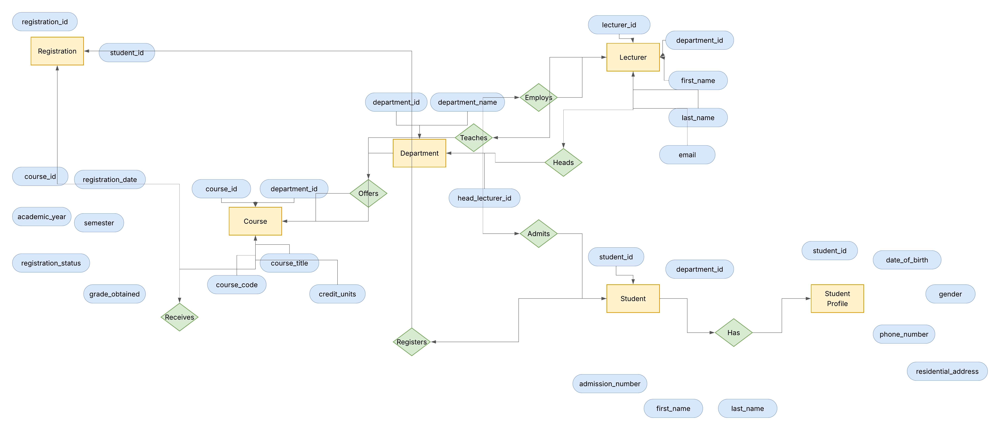
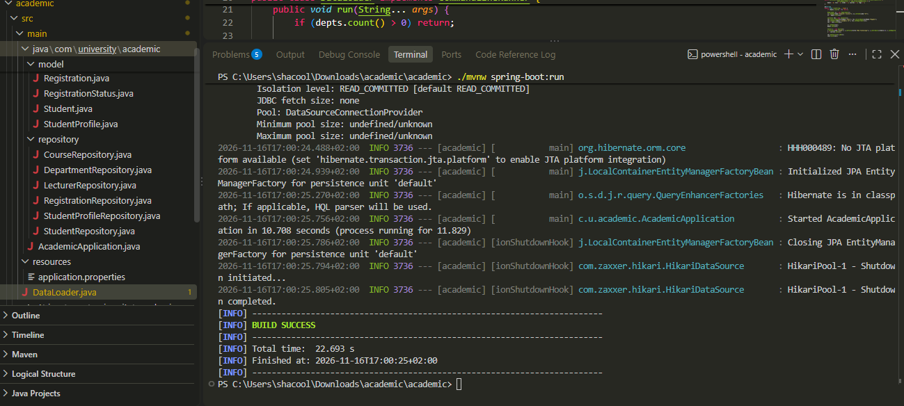
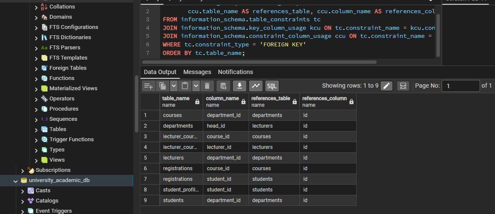
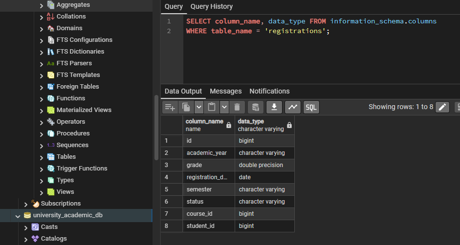
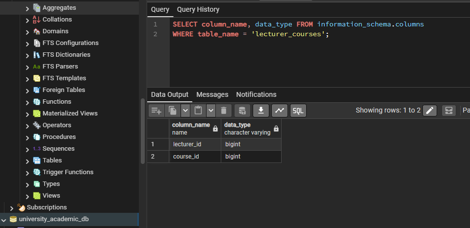
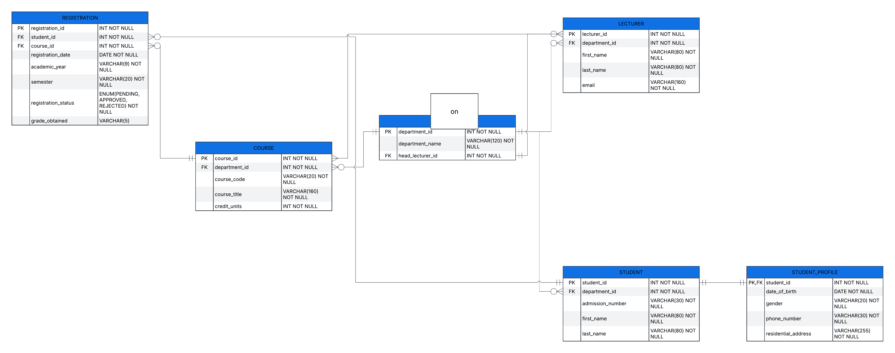

# university-academic-system

1. Entities and attributes
   
Entity	                        Attributes
Department	                   id, name, code
Lecturer	                     id, firstName, lastName, email
Student	                       id, firstName, lastName, email, registrationNumber
StudentProfile	               id, dateOfBirth, gender, phoneNumber, address
Course	                       id, code, title, credits
Registration (join entity)	   id, registrationDate, academicYear, semester, status, grade

3. Relationships, cardinality, and keys
   
Relationship	                             Cardinality	             Implementation
Department → Lecturer (employs)	           One-to-Many	             FK department_id in lecturers
Department → Lecturer (head)	             One-to-One	               FK head_id in departments
Department → Student	                     One-to-Many	             FK department_id in students
Department → Course	                       One-to-Many	             FK department_id in courses
Student → StudentProfile	                 One-to-One	               FK student_id (unique) in student_profiles
Lecturer ↔ Course	                         Many-to-Many	             Join table lecturer_courses (no entity)
Student ↔ Course	                         Many-to-Many	            Join entity Registration (it has extra attributes)

4. Relational schema (put in README)
departments(id PK, name, code, head_id FK→lecturers.id UNIQUE)
lecturers(id PK, first_name, last_name, email, department_id FK→departments.id)
students(id PK, first_name, last_name, email, registration_number, department_id FK→departments.id)
student_profiles(id PK, date_of_birth, gender, phone_number, address, student_id FK→students.id UNIQUE)
courses(id PK, code, title, credits, department_id FK→departments.id)
lecturer_courses(lecturer_id FK→lecturers.id, course_id FK→courses.id, PK(lecturer_id, course_id))
registrations(id PK, registration_date, academic_year, semester, status, grade,
              student_id FK→students.id, course_id FK→courses.id, UNIQUE(student_id, course_id))

   

reason for choosing this:

Join table is for Lecturer↔Course because the assignment says no separate entity, and there are no extra attributes.
Join entity is for Student↔Course because the relationship carries its own data (date, year, semester, status, grade), so it must be a real entity with two @ManyToOne links.
Foreign key goes on the “many” side of every one-to-many.

#### screenshots 

## Entity Relationship Diagram

## Screenshots

### 1. Application running and Hibernate creating tables

### 2. Generated tables in PostgreSQL (7 tables)

### 3. Foreign key relationships

### 4. Registrations table (join entity)

### 5. Lecturer-Course join table

### 6. Schema

